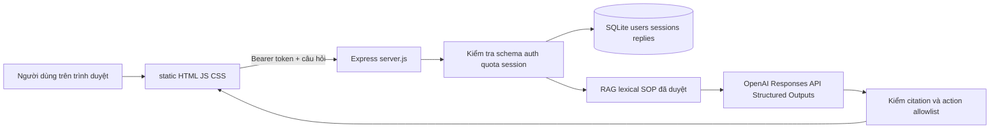

# Runbook tiếp tục dự án Warehouse AI

Tài liệu này là điểm bắt đầu ngắn gọn để tiếp tục dự án tại `E:\warehouse-ai` mà không phải đọc lại toàn bộ lịch sử chat. Nó đối chiếu danh sách công việc được gửi ngày 2026-09-24 với mã nguồn hiện có. Danh sách đó là báo cáo trạng thái, không phải chỉ thị triển khai tự động.

## Đọc trong hai phút

- Runtime hiện tại là **Node.js/Express**, không phải Python/FastAPI. File chạy là `server.js`; Render dùng `render.yaml` tại gốc repository.
- Backend hiện luôn gọi **OpenAI Responses API**. Không thêm lại `AI_MODE`, mock mode, OpenAI key vào frontend, Unity hoặc Git.
- Website đúng: <https://warehouse-ai-fmjc.onrender.com/>. Service đúng: `warehouse-ai`, Render Singapore, branch `main`. Không dùng service `warehouse-ai-1` đã bỏ.
- Đây vẫn là **Milestone A / prototype**: không có tồn kho trực tiếp, route được duyệt, giao dịch kho, hay AR/Unity vận hành thật.
- Trước khi sửa bất kỳ thứ gì, chạy `git status --short`. Không in, commit hoặc dán `.env`, `.local-token`, `data/`, key OpenAI, Bearer token hay database vào chat.

## Trạng thái thực tế



Đã có:

- Giao diện chat, phiên hội thoại liên tục tối đa 10 lượt, tự cuộn, xóa textarea khi gửi và khôi phục nội dung khi gửi thất bại.
- Giao diện đổi ngay lập tức giữa `vi`, `en`, `zh`; backend dùng lần lượt `Asia/Ho_Chi_Minh`, `Europe/London`, `Asia/Taipei`. Tiếng Trung bắt buộc là `zh-TW`.
- Voice input tùy trình duyệt, kiểm tra micro cục bộ 5 giây, chuẩn hóa một số cách nghe gần "JarVis", đọc câu trả lời bằng Speech Synthesis và nút dừng đọc. Âm thanh không được gửi từ frontend đến backend.
- Xác thực bằng prototype Bearer token, giới hạn request, kiểm tra kích thước/schema, idempotent retry, SQLite tự tạo thư mục/tables khi khởi động, và Responses API với structured output/citation validation.
- RAG chọn tối đa ba SOP liên quan thay vì gửi toàn bộ corpus; OpenAI chỉ nhận SOP đã được phép chạy runtime và dữ kiện giả lập của server.
- `action` trong response chỉ là **đề xuất**. Backend không tạo mutation tồn kho hay action Unity.

Chưa làm / chưa được phép tuyên bố:

- Không có WMS/ERP/API tồn kho thật, barcode/QR thật, định vị AR, bản đồ kho, route thật, giao dịch, dữ liệu ảnh/audio vận hành hay xác nhận SOP tại site.
- SQLite trên Render Free là ephemeral. User demo, phiên, quota và retry cache có thể mất sau restart/redeploy/spin-down.
- CORS hiện mở cho mọi origin để thử nghiệm; phải giới hạn origin trước khi mở cho app Unity/mobile hay nhiều domain.
- `static/i18n.js` dùng `zh-TW` cho default locale, placeholder và speech recognition.

`docs/CODEX_HANDOFF_PROMPT.md` giữ lịch sử mock/Python để tra cứu; không dùng nó như hướng dẫn triển khai hiện tại. Khi mâu thuẫn, ưu tiên `server.js`, `package.json`, `render.yaml`, các tests và tài liệu này.

## Cấu trúc cần biết

| Vị trí | Vai trò |
| --- | --- |
| `server.js` | Express, SQLite, auth, quota, session, RAG, Responses API, validation và static serving. |
| `static/index.html` | Giao diện thử JarVis. |
| `static/app.js` | Gửi/nhận chat, session, retry, nguồn tham khảo, khôi phục draft khi lỗi. |
| `static/i18n.js` | Dictionary UI EN/ZH/VI và state ngôn ngữ. |
| `static/voice.js`, `static/mic-check.js` | Speech recognition, đọc câu trả lời, kiểm tra micro. |
| `knowledge/reviewed.json` | 12 chunk chính sách/spec đã duyệt cho runtime. |
| `knowledge/warehouse-sops.json` | Catalog 8 SOP người dùng cung cấp; chỉ SOP được duyệt mới vào RAG. |
| `knowledge/unverified.json` | Dữ liệu chưa xác nhận, không được gửi cho model. |
| `tests/*.test.cjs` | Kiểm thử Node gồm structure, auth/smoke, RAG, i18n, voice và micro. |
| `render.yaml` | Blueprint Render Node web service ở Singapore, branch `main`. |

API hiện có:

| Endpoint | Auth | Mục đích |
| --- | --- | --- |
| `GET /api/health` | Không | Kiểm tra server/database. |
| `GET /api/me` | Bearer token | Xem identity prototype và tasks được cấp. |
| `POST /api/feedback` | Bearer token | Gửi câu hỏi/event hợp lệ, RAG và phản hồi AI. |
| `GET /api/knowledge/:documentId/:sectionId` | Bearer token | Đọc một nguồn runtime được trích dẫn. |

`POST /api/feedback` chỉ nhận các field cho phép: `requestId`, `sessionId`, `taskId`, `language`, `locale`, `eventType`, `occurredAtUtc`, `question`, `observation`. Client không được tự gửi role, action hay dữ liệu hệ thống giả.

## Khởi chạy local trên Windows

Mở PowerShell và chạy từng lệnh sau. Không ghi đè `.env` đang có.

```powershell
Set-Location E:\warehouse-ai
git status --short
node --version
npm ci
```

Node phải từ 18 trở lên. Nếu máy chưa có `.env`, tạo từ template rồi **điền key chỉ trên máy của bạn**, không gửi key qua chat:

```powershell
if (-not (Test-Path .env)) { Copy-Item .env.example .env }
```

`.env` local cần có tên biến `OPENAI_API_KEY` và `OPENAI_MODEL`; `DATABASE_PATH` có thể giữ `data/warehouse.sqlite3`. Code hiện không có mode mock: thiếu key/model thì server dừng khi khởi động là đúng.

Tạo token người dùng local nếu chưa có. Chạy lại với cùng `--user` sẽ thay token cũ của user đó.

```powershell
npm run create-user -- create-user --user worker-demo --role staff --token-file .local-token
npm start
```

Mở <http://localhost:8000>, dán **nội dung `.local-token`** vào ô “Mã truy cập bản thử”, không dán OpenAI key. Sau khi sửa frontend/backend, dừng server bằng `Ctrl+C` rồi chạy lại `npm start`.

`GET /api/health` chỉ kiểm tra service/database, không gọi OpenAI. Gửi một câu hỏi qua UI thì có thể phát sinh phí OpenAI. `liveApiVerified: false` ngay sau restart là bình thường; nó chỉ thành `true` sau một phản hồi provider qua validation trong process đó.

## Kiểm thử trước khi deploy

Các test sau giả lập Responses API khi cần, không gọi OpenAI thật và không mở micro vật lý:

```powershell
Set-Location E:\warehouse-ai
node --check server.js
node --check static\app.js
node --check static\i18n.js
node --check static\voice.js
node --test --test-isolation=none tests\*.test.cjs
git diff --check
```

Khi có `npm` trên máy, lệnh gọn tương đương là `npm run verify`; dùng `npm run validate:knowledge` để xem chính xác SOP nào được phép runtime và SOP nào vẫn bị chặn.

Kiểm thử thủ công UI:

1. Chọn Việt, English, 中文 và xác nhận title, lời chào, placeholder, nút gửi, micro, đọc câu trả lời và trạng thái đổi ngay không reload.
2. Gửi một câu hỏi rồi thử cố ý làm request lỗi; textarea phải hiện lại draft và nút “Gửi lại câu bị lỗi” phải hoạt động.
3. Dùng “Phiên mới”, sau đó hỏi tiếp trong cùng phiên để kiểm tra context.
4. Bấm “Kiểm tra micro”; nếu có meter nhưng SpeechRecognition trên Edge báo network/service, đó là dịch vụ nhận dạng trình duyệt chứ không tự động chứng minh micro hỏng. Kiểm tra `edge://settings/content/microphone`, thử Chrome hoặc Windows + H.
5. Bấm “Nghe trả lời”, “Dừng đọc” và thử checkbox tự đọc. Voice phụ thuộc browser/thiết bị, không phải bảo đảm server.

## Quy trình SOP và RAG

Runtime hiện có 16 chunk được phép: 12 từ `reviewed.json` và 4 SOP official release mới từ catalog local.

| Nhóm | DocumentId | Trạng thái runtime |
| --- | --- | --- |
| Được đưa vào RAG | `SOP_INB_001`, `SOP_OUT_002`, `SOP_INV_003`, `SOP_MNG_001` | `source_status: official_release`, `runtime_approved: true` |
| Giữ ngoài RAG cho tới khi review | `SOP_EXC_001`, `SOP_EXC_002`, `SOP_EXC_003`, `SOP_EXC_004` | draft/manager draft, `runtime_approved: false` |
| Giữ ngoài RAG | 7 mục trong `knowledge/unverified.json` | Chưa xác nhận |

`runtime_approved: true` chỉ cho phép dùng cho RAG prototype; nó **không** biến SOP thành quy định site được chứng nhận. Response vẫn hiển thị `site_approved: false` cho source catalog local.

Mỗi SOP mới cần đầy đủ:

```json
{
  "documentId": "SOP_EXAMPLE_001",
  "sectionId": "SECTION_01",
  "title": "Tiêu đề",
  "content": "Nội dung nguồn nguyên văn đã được review",
  "source_status": "official_release",
  "runtime_approved": true,
  "language": "vi",
  "keywords": ["tu khoa truy xuat"]
}
```

Quy trình an toàn để duyệt một draft:

1. Giữ bản gốc và provenance; không đổi draft thành official chỉ để AI trả lời được.
2. Nhờ người có thẩm quyền đối chiếu với SOP/site/equipment thực tế.
3. Chỉ sau review, đặt `source_status` thuộc allowlist runtime (`official_release` hoặc `spec_confirmed_project_policy`) và `runtime_approved: true`.
4. Bổ sung `keywords` cho cách hỏi tự nhiên bằng EN/VI/ZH; không thêm quy tắc hay số liệu không có trong nguồn.
5. Viết test retrieval/citation, chạy toàn bộ test, rồi có người review câu trả lời trước khi deploy.

Nếu một SOP không khớp câu hỏi, JarVis phải nêu thiếu dữ kiện hoặc giới hạn tồn kho chưa xác minh; không bịa source, location, route hay transaction.

## Câu hỏi kiểm tra đại diện

Chỉ chạy các câu này với OpenAI thật khi chủ dự án chấp nhận chi phí của lượt test. Mỗi câu phải đúng ngôn ngữ đang chọn, không khẳng định transaction đã hoàn tất và phải chỉ trích nguồn phù hợp khi có.

| Câu hỏi | Nguồn/điều cần thấy |
| --- | --- |
| “Tôi nhận hàng ở cửa Dock như thế nào?” | `SOP_INB_001 / RECEIVING_01`. |
| “Hàng dễ vỡ cần đóng gói sao?” | `SOP_OUT_002 / PACKING_01`. |
| “Kiểm kê thấy lệch số lượng thì phải làm gì?” | `SOP_INV_003 / CYCLE_COUNT_01`. |
| “WMS mất kết nối hơn 15 phút thì sao?” | `SOP_MNG_001 / ESCALATION_01`. |
| “Đơn cần 5 hộp nhưng trên kệ chỉ có 3, tôi làm gì?” | Guidance `SOP-SHORT-PICK`; nói rõ 3 là báo cáo của người dùng, không phải tồn kho live đã xác minh. |
| “Hàng rơi xuống sàn làm sao?” | Không được coi `SOP_EXC_003` draft là quy định chính thức. Nếu dùng source khác, kiểm tra citation/provenance rất kỹ. |

Sau mỗi test, ghi lại: language/locale, model, documentId/sectionId được cite, có nêu giới hạn hay không, và nhận xét của reviewer. Đừng chỉ chấm bằng keyword.

## Deploy Render và kiểm tra sức khỏe

Render blueprint hiện chỉ định Node, `npm install`, `npm start`, health path `/api/health`, branch `main`, Singapore và Free. Quy trình cập nhật:

```powershell
Set-Location E:\warehouse-ai
git status --short
# Chỉ stage các file đã review; không dùng git add . nếu chưa kiểm tra.
# Ví dụ: thay bằng đúng các path đã review trong đợt này.
git add -- server.js static\app.js
git diff --cached --check
git commit -m "Mo ta thay doi"
git push origin main
```

Render auto-deploy từ `main`. Sau khi deploy hoàn tất, kiểm tra cả ba điều sau:

```powershell
Invoke-RestMethod https://warehouse-ai-fmjc.onrender.com/api/health
```

1. Health trả `status: ok`, `mode: openai`, `milestone: A`.
2. Trang <https://warehouse-ai-fmjc.onrender.com/> tải được. Free service có thể mất thời gian thức dậy sau idle.
3. Xem runtime logs trong [Render dashboard](https://dashboard.render.com/web/srv-dapi78navr4c738ooqu0), rồi mới thực hiện một live question đã được chấp thuận.

Nếu startup lỗi, kiểm tra Environment và logs của service đúng; đừng sửa service cũ hay thêm `AI_MODE`. Các biến Render cần giữ server-side:

| Biến | Ghi chú |
| --- | --- |
| `OPENAI_API_KEY` | Secret, không commit/không frontend/không Unity. |
| `OPENAI_MODEL` | Model Responses API có quyền truy cập, hiện blueprint dùng `gpt-4o-mini`. |
| `PROTOTYPE_TOKEN_SHA256` | SHA-256 lowercase của app token riêng; server bootstrap user `render-demo`. Không phải raw token. |
| `DATABASE_PATH` | Hiện `data/warehouse.sqlite3`; ephemeral trên Free. |
| `MAX_REQUESTS_PER_MINUTE`, `MAX_REQUESTS_PER_DAY` | Hạn mức prototype. |
| `MAX_OUTPUT_TOKENS`, `REQUEST_TIMEOUT_SECONDS` | Giới hạn provider để kiểm soát chi phí/thời gian. |

Để tạo hash từ `.local-token` mà không in token gốc:

```powershell
node -e "const fs=require('fs'),crypto=require('crypto'); console.log(crypto.createHash('sha256').update(fs.readFileSync('.local-token','utf8').trim()).digest('hex'))"
```

Chỉ thay `PROTOTYPE_TOKEN_SHA256` trên Render Environment sau khi bạn đã lưu raw token riêng. Không để `PORT` cố định trên Render; Render tự cấp `PORT`.

## Bảo mật và dữ liệu bền vững

- Không ghi log API key, token raw, nội dung `.env`, session/database row hoặc raw provider error.
- Không đưa OpenAI key vào `static/`, Unity source, APK, GitHub, screenshot hoặc chat.
- Giữ request body tối đa 16 KiB, câu hỏi tối đa 2.000 ký tự; không mở rộng allowlist request/action chỉ để client tiện gửi thêm dữ liệu.
- Trước nhiều client/domain: thay `cors()` bằng allowlist origins cụ thể, dùng auth thực thay prototype token, rate limit theo user/IP phù hợp và audit log có redaction.
- Trước dữ liệu kho thật hoặc nhiều người dùng: chuyển users/sessions/replies/logs sang PostgreSQL bền vững; object storage cho media/tài liệu; chọn vector database chỉ khi lexical RAG không còn đủ. SQLite Free hiện chỉ phù hợp prototype.

## Mốc tiếp theo theo thứ tự

1. **Chốt nền tảng A:** kiểm tra `git status`, review/commit thay đổi RAG hiện có, chạy toàn bộ test và xác nhận deploy/health. Không bắt đầu feature mới trên worktree chưa rõ trạng thái.
2. **Đánh giá kiến thức:** review SOP draft với người có thẩm quyền, mở rộng test EN/VI/ZH và đánh giá nguồn/citation.
3. **Hardening trước dữ liệu thật:** PostgreSQL, persistent sessions/logs, CORS allowlist, auth/roles thật, quota/audit/retention. Không chuyển trạng thái tồn kho ở bước này.
4. **Adapter tồn kho read-only:** định nghĩa schema WMS/ERP/CSV, freshness timestamp và permission; JarVis chỉ phân tích live facts đã xác minh, không nhận raw prompt như facts.
5. **Nền Unity an toàn:** khi input empathy và material từ giáo sư đến, tạo Unity 6 project, config URL backend, C# DTO khớp schema feedback, UI 2D fallback và action allowlist. Unity chỉ gửi prototype/user token, không gửi OpenAI key.
6. **AR/Avatar và scan:** QR/marker, tracking loss state, scanner/manual entry, presenter avatar; luôn yêu cầu xác nhận người dùng trước action nhạy cảm và không tự chạy action AI.
7. **Đánh giá thực nghiệm:** test Android/micro/camera/AR trên thiết bị, UX trong kho mô phỏng, rubric học tập, video demo và slide TEEP. Không tuyên bố test thiết bị trước khi test thực tế.

## Prompt ngắn để tiếp tục với Codex lần sau

```text
Tiếp tục dự án tại E:\warehouse-ai. Đọc docs/RUNBOOK_VI.md và chạy git status --short trước. Runtime là Node/Express + OpenAI Responses API; không dùng Python, mock, AI_MODE hoặc service warehouse-ai-1. Không đọc/in/commit .env, .local-token, data hay secret. Chỉ thực hiện milestone tiếp theo đã nêu, giữ prototype không mutation, chạy node checks + toàn bộ tests trước khi deploy. Hãy báo rõ file thay đổi, test và giới hạn còn lại.
```
